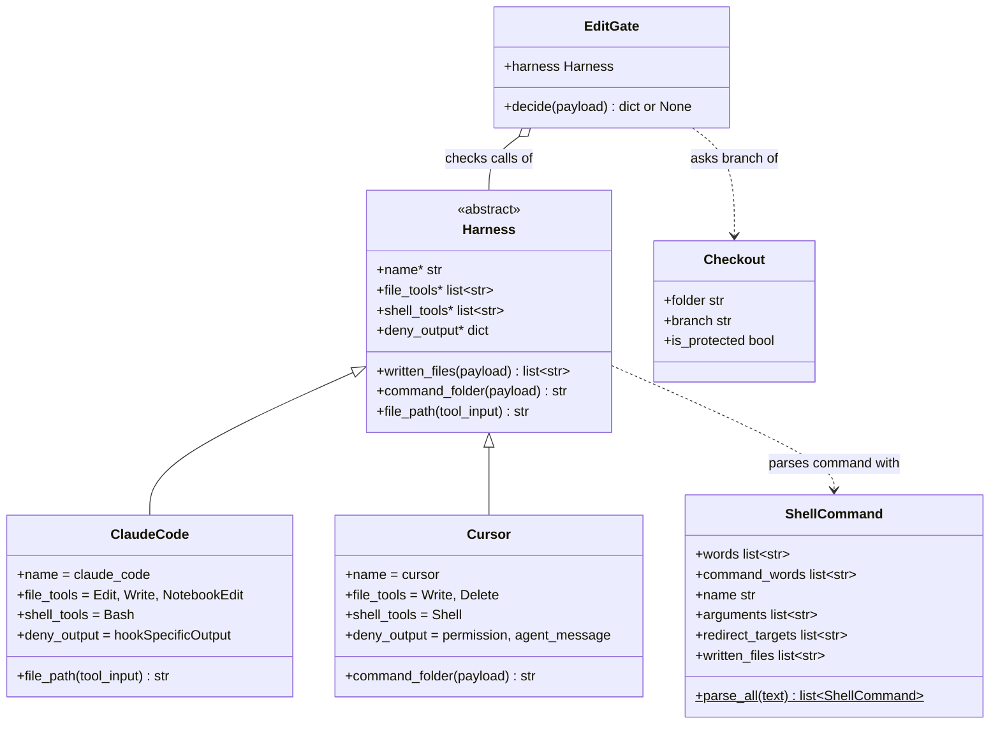

# Classes

The edit gate is one `EditGate` run for one `Harness`. The harness says which
files a tool call writes and how to deny, and the gate reads the branch of each
of those files.

## How to read it

1. `<|--` is inheritance.
   1. `ClaudeCode` and `Cursor` set the four values that `Harness` marks
      abstract with `*`.
   2. Each overrides only the method its payload needs: `ClaudeCode` reads
      `notebook_path`, and `Cursor` falls back to the first workspace root.
2. `o--` means the gate holds a harness it did not create.
   1. `edit_gate.py` creates it from the harness name given on the command
      line.
3. `..>` is a dependency.
   1. The gate creates one `Checkout` per file the harness says is written.
   2. `Harness` uses `ShellCommand` to find the files a shell command writes.
4. `$` marks a class method, and `+` a public member.
5. `folder`, `branch`, `is_protected` and the `ShellCommand` members after
   `words` are properties, shown as attributes.

## Outside the classes

| Name | File | What it holds |
|---|---|---|
| `DENY_MESSAGE` | `src/harness.py` | The reason every harness gives when it denies |
| `HARNESSES` | `src/harness.py` | Each subclass's `name` to the subclass, for the command line |
| `PROTECTED_BRANCHES` | `src/edit_gate.py` | The branches the gate protects |
