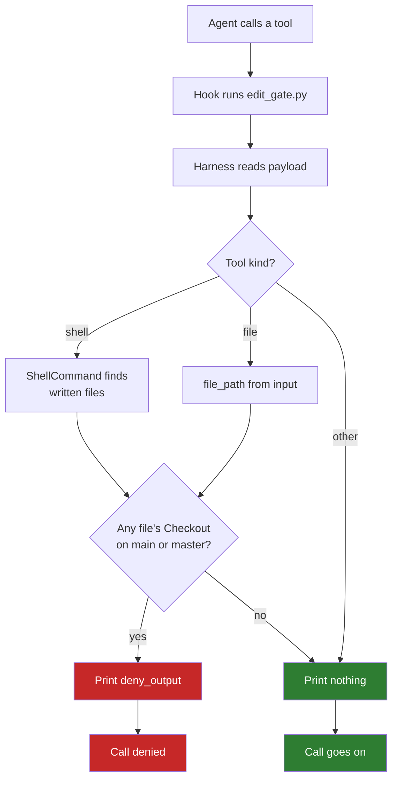

# Flow

Each time the agent is about to call a writing tool, its hook runs
`edit_gate.py` with the harness's name, and the gate answers before the call
runs. In the diagram, red ends the call and green lets it go on.

| Step | What happens | Where |
|---|---|---|
| Hook runs | The harness's hooks file runs `edit_gate.py claude_code` or `edit_gate.py cursor`, with the payload on stdin | `hooks/` |
| Reads payload | The gate hands the payload to its harness | `Harness.written_files` |
| Tool kind | The harness's `shell_tools` and `file_tools` say which kind the tool is | `Harness` |
| Written files | A shell command's files are joined to its folder; Cursor's empty `cwd` falls back to the first workspace root | `Harness.command_folder` |
| File tool's file | The input's `file_path`, or Claude Code's `notebook_path` | `Harness.file_path` |
| Branch check | `Checkout` reads the branch of the closest existing folder above each file | `Checkout` |
| Answer | `edit_gate.py` prints the deny in the harness's own format, and prints nothing to let the call go on | `edit_gate.py` |

A file outside any repository has no branch, so it never counts as protected.
