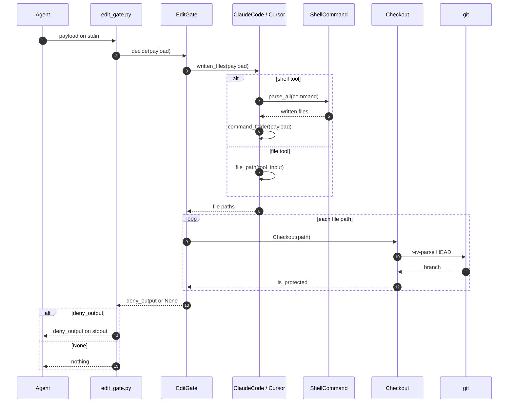

# Sequence

Who calls whom while the gate answers one tool call, from the agent's hook to
`git` and back.

| Step | What happens |
|---|---|
| ① | The harness's hook starts `edit_gate.py` with its name, and sends the tool call as JSON on stdin. |
| ② | `edit_gate.py` builds the `EditGate` for that harness and asks it to decide on the payload. |
| ③ | The gate asks its harness which files the call writes. |
| ④–⑥ | For a shell tool, `ShellCommand` finds the files the command writes, and the harness joins each to the command's folder. |
| ⑦ | For a file tool, the harness reads the file from the input. |
| ⑧ | The gate gets the paths; any other tool gives none, and the call goes on. |
| ⑨–⑫ | For each path, `Checkout` finds the closest existing folder and asks `git` for its branch. |
| ⑬ | The gate returns the harness's deny when any file is on `main` or `master`, and None otherwise. |
| ⑭ | `edit_gate.py` prints the deny, and the agent does not run the call. |
| ⑮ | Otherwise it prints nothing, and the call goes on. |

The gate stops at the first protected file, so `git` may run fewer times than
there are files.

Steps ⑥ and ⑦ are where each harness steps in: `Cursor` falls back to the
first workspace root when `cwd` is empty, and `ClaudeCode` reads
`notebook_path` for `NotebookEdit`.
